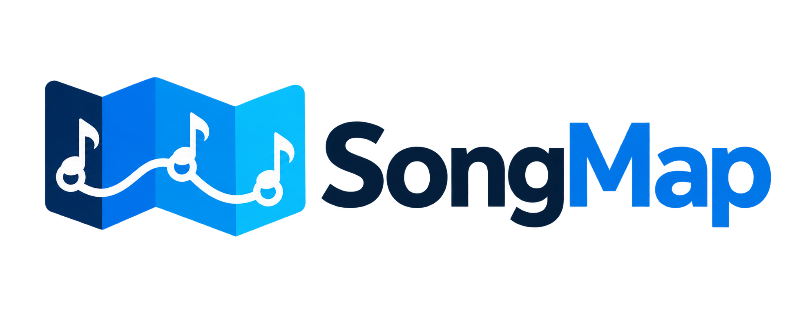
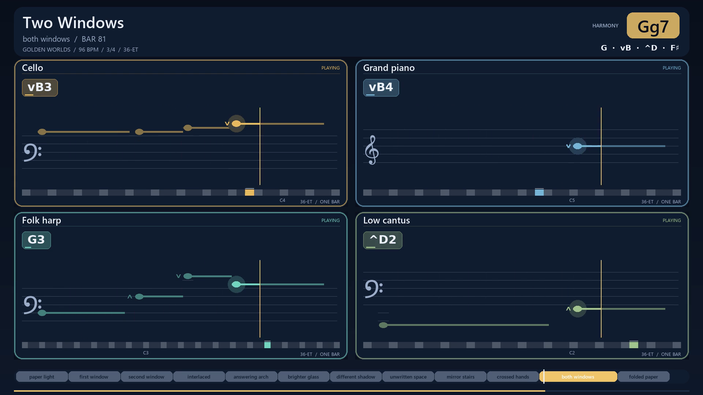
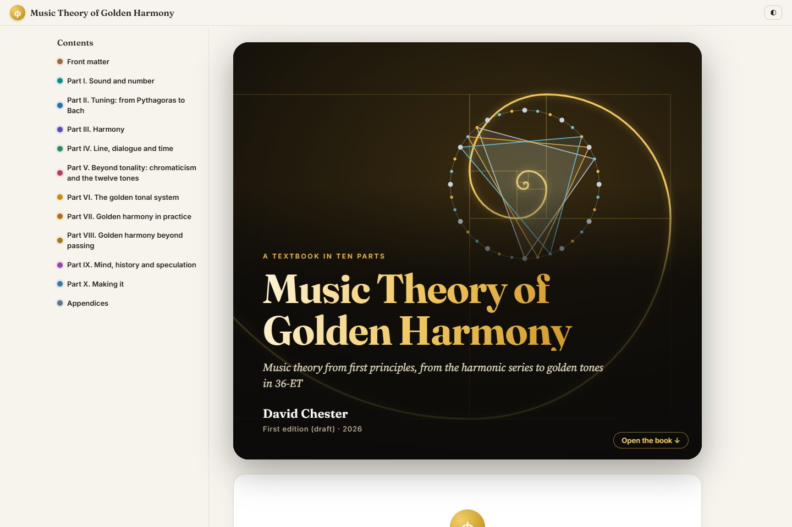
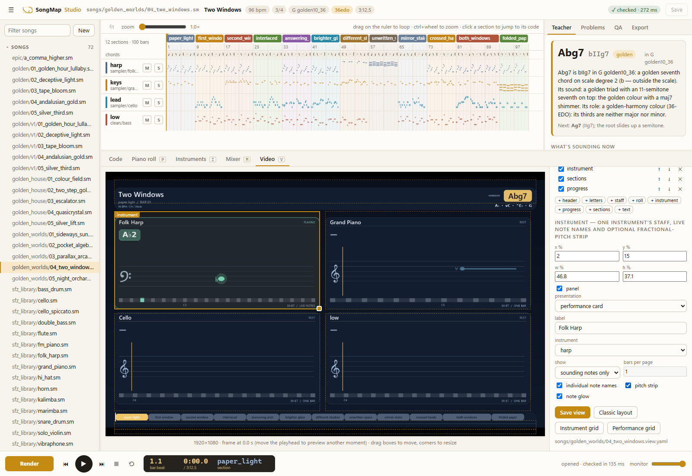

<p align="center">
  <picture>
    <source media="(prefers-color-scheme: dark)" srcset="docs/brand/songmap-logo-dark.png">
    
  </picture>
</p>

<h1 align="center">SongMap</h1>

<p align="center">
  Write music as text, hear it come to life, and see how the parts fit together.
</p>

<p align="center">
  <a href="https://github.com/davidQuantumGravity/songmap/actions/workflows/ci.yml"></a>
  <a href="pyproject.toml"></a>
  <a href="LICENSE"></a>
</p>

<p align="center">
  <a href="https://deeperresearch.ai/music_theory_of_golden_harmony/"><b>📖 Read the interactive textbook</b></a>
  · <a href="#try-songmap">Get started</a>
  · <a href="#songmap-studio">Explore Studio</a>
  · <a href="songs/">Browse scores</a>
</p>

SongMap turns editable `.sm` or YAML scores into music. Describe your chords, melodies, instruments and sections, then render a complete mix, individual stems, or a video that follows the notes. Work in familiar tuning or explore the smaller pitch steps of **36-tone equal temperament (36-ET)** and golden harmony.

## What can you make?

| | What SongMap does |
|---|---|
| 🎼 **Write and arrange** | Combine melodies, chord progressions, reusable motifs, drum patterns and named sections. Shape phrasing with dynamics, articulation, groove and timing. |
| 🎹 **Choose your sound** | Use built-in synthesizers, piano, organ, plucked strings, bass and drums. Add recorded orchestral and acoustic instruments with the optional sample library. |
| 🖥️ **Work in Studio** | Edit score text, follow the arrangement and piano roll, audition instruments, adjust the mix and design video layouts in your browser. |
| 🎬 **See the music** | Export videos with moving notation, note names and separate instrument panels. Place soundtrack cues on exact video frames. |
| 🧪 **Compare ideas** | Use AI Lab to save instrument A/B comparisons, listen in context or solo, record preferences, and preview, apply or undo selected score changes. |
| 🌀 **Explore harmony** | Write ordinary major and minor music, or try golden chords, microtonal scales, voice leading and modulation in 36-ET. |

## Hear it, then follow the notes

[](docs/VIDEO.md)

**[Listen to complete songs →](https://deeperresearch.ai/music_theory_of_golden_harmony/chapters/ch47.html)** The textbook pairs full pieces with listening guides and explanations of the musical choices. Try [five golden-harmony songs](https://deeperresearch.ai/music_theory_of_golden_harmony/chapters/ch47.html) or the [Golden House electronic collection](https://deeperresearch.ai/music_theory_of_golden_harmony/chapters/ch49.html).

The image above is a frame from *Two Windows*, an editable score in [Golden Worlds](songs/golden_worlds/). Each instrument has its own staff, sounding note names and pitch strip, with the current harmony and section shown alongside.

## Learn with the interactive textbook

**[Music Theory of Golden Harmony](https://deeperresearch.ai/music_theory_of_golden_harmony/)** starts with sound and the harmonic series, builds up Western harmony, then explores golden intervals, chords and scales. Listen to the examples as you read, follow the notation in videos, and switch between **Hear it**, **Understand it** and **Derive it** for different levels of detail.

[](https://deeperresearch.ai/music_theory_of_golden_harmony/)

- **[Start with sound and waves](https://deeperresearch.ai/music_theory_of_golden_harmony/chapters/ch01.html)** if you are learning music theory from the beginning.
- **[Meet 36-ET](https://deeperresearch.ai/music_theory_of_golden_harmony/chapters/ch24.html)** to see how the tuning extends the familiar twelve notes.
- **[Hear complete songs](https://deeperresearch.ai/music_theory_of_golden_harmony/chapters/ch47.html)** to explore golden harmony in an ensemble.
- **[Browse the textbook sources](textbook/)** to study or change the chapters and their editable example scores. The online book is a draft edition.

A proposed two-volume set, **[Rational and Irrational Harmony](docs/RATIONAL_AND_IRRATIONAL_HARMONY.md)**, extends this direction into a history of music theory across cultures and a broader exploration of irrational harmonic systems.

## SongMap Studio

[](docs/GUI.md)

Studio runs locally in your browser and opens the same score files you can edit by hand. The arrangement shows where each part enters, the harmony teacher explains the current chord, and the instrument, mixer and video views let you shape the result.

Open the **AI Lab** dock for saved instrument comparisons and listening feedback. AI proposals use an installed, signed-in Codex CLI; manual comparisons work without it. Your listening choices guide the next proposal. See the [AI Lab guide](docs/AI_LAB.md) for setup and the [songwriting vision](docs/AI_SONGWRITING_VISION.md) for planned extensions.

## Try SongMap

You need **Python 3.12 or newer** and Git. In a terminal:

```bash
git clone https://github.com/davidQuantumGravity/songmap.git
cd songmap
python -m venv .venv
```

Activate the environment:

| Windows PowerShell | macOS / Linux |
|---|---|
| `.\.venv\Scripts\Activate.ps1` | `source .venv/bin/activate` |

Install SongMap and open a score in Studio:

```bash
python -m pip install -e ".[gui,sampler]"
songmap gui examples/week_oct13_swarm.sm
```

Studio opens in your browser. The built frontend is included, so Node.js is only needed if you want to develop Studio itself.

Prefer the command line? Check and render the same score:

```bash
songmap check examples/week_oct13_swarm.sm
songmap render examples/week_oct13_swarm.sm -o build/swarm
```

The render folder contains `song.wav`, a `stems/` folder, frame-accurate `cues.json`, and technical and arrangement reports (`qa.json`, `qa.png`, `review.json`). Automated checks help find problems; listening remains part of the process.

<details>
<summary><b>Add recorded instruments or export MP3 / video</b></summary>

Install just the sample voices you want:

```bash
songmap samples install grand_piano flute
songmap samples verify
```

The full library is optional. See the [sample library guide](docs/SFZ_LIBRARY.md) for its catalog, sources and playback limits, or the [bass and drum palette](docs/BASS_DRUM_PALETTE.md) for grooves and rhythm-section examples.

Install [FFmpeg](https://ffmpeg.org/download.html) and put it on your `PATH` for MP3 and video exports:

```bash
songmap render examples/week_oct13_swarm.sm -o build/swarm --mp3
songmap video examples/week_oct13_swarm.sm -o build/swarm/swarm.mp4
```

Downloaded samples, rendered audio and videos stay outside Git. Listening-page HTML in `songs/` needs its rendered media locally; the public textbook includes hosted listening examples.

</details>

## A small score you can change

Save this as `first_steps.sm`. It uses the built-in instruments, so no sample download is needed.

```text
song "First steps" 120 4/4 C seed=7
chords C Am F G /1
motif tune rel "=mp R4 3@72 5@88 3@76 | R2@80 5@68"
intro 4 | pad:warm(oct=-1) bass:sub dyn=p
theme 8 | like=intro drums:four_floor lead:tune:oct=1 dyn=mf
outro 4 | pad:warm(oct=-1) chords="C:4" dyn=p
```

The header sets the tempo, meter and key. Each section gives its length in bars and the parts that play. The melody follows the current chord's root, third and fifth, with `@` marks shaping note velocities. `like=intro` reuses the intro's parts, then adds drums and a melody at a louder dynamic.

```bash
songmap check first_steps.sm
songmap render first_steps.sm -o build/first_steps
songmap gui first_steps.sm
```

Try changing `120` to another tempo, replacing a chord, or muting a part in Studio. For the full notation, open the [compact format guide](docs/COMPACT_FORMAT.md) or run `songmap describe --compact` to see the available instruments and styles. YAML scores work too, and `songmap fmt` converts between the formats.

## Where to go next

| I want to… | Start here |
|---|---|
| Write a score or soundtrack | [Score format](docs/COMPACT_FORMAT.md) · [Language reference](docs/LANGUAGE.md) · [Performance and expression](docs/PERFORMANCE.md) |
| Explore sounds and grooves | [Instruments](docs/INSTRUMENTS.md) · [Recorded sample library](docs/SFZ_LIBRARY.md) · [Bass and drums](docs/BASS_DRUM_PALETTE.md) |
| Make visual performances | [Video guide](docs/VIDEO.md) · [Studio guide](docs/GUI.md) |
| Explore golden harmony | [Golden harmony](docs/GOLDEN_HARMONY.md) · [Theory](docs/GOLDEN_THEORY.md) · [Progressions](docs/GOLDEN_PROGRESSIONS.md) · [Math and history](docs/GOLDEN_MATH.md) |
| Compose with a coding agent | [Agent instructions](AGENTS.md) · [Composition skill](.claude/skills/songmap-compose/SKILL.md) |
| Understand or extend the engine | [Architecture](docs/ENGINE.md) · [Design](docs/DESIGN.md) · [YAML specification](docs/SONGMAP_SPEC.md) · [Roadmap](ROADMAP.md) |

<details>
<summary><b>Developing SongMap</b></summary>

The Python engine lives in `songmap/`, Studio's React source in `songmap/gui/web/`, editable music in `songs/` and `examples/`, and textbook sources in `textbook/`.

```bash
python -m pip install -e ".[dev,gui,sampler]"
python -m pytest -q -m "not port"
```

The portable suite runs without the private Oct-13 reference recordings. With those files available in `assets/oct13/`, `python -m pytest -q` also runs the original-audio comparison tests. The original prototype is preserved in `reference/synth_v0.py`; [scene timelines](docs/SCENE_TIMELINES.md) and the [rescore plan](docs/RESCORE_PLAN.md) document those soundtracks.

To work on Studio, install Node.js 24, then run:

```bash
npm --prefix songmap/gui/web ci
npm --prefix songmap/gui/web run build
```

`main` holds the engine, Studio, guides and scores in one project. Use branches or linked worktrees for changes. GitHub Actions tests Python 3.12 and 3.14 and builds Studio with Node.js 24. Sample libraries, renders, AI Lab sessions and scratch files remain local.

</details>

SongMap is available under the [MIT license](LICENSE).
